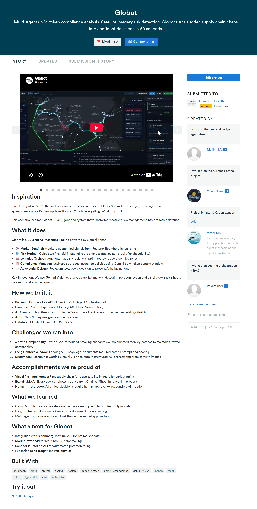
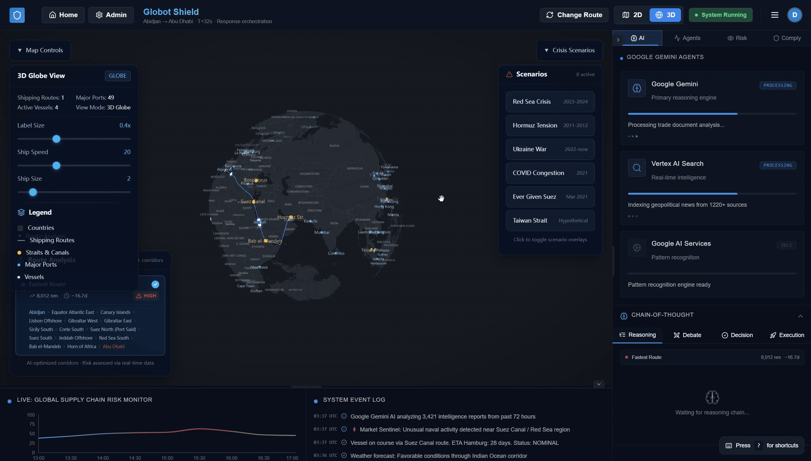
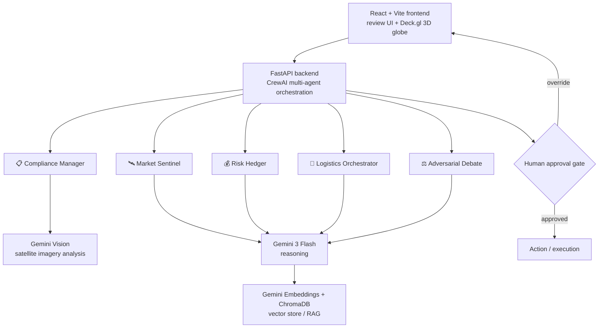

# Globot

[](docs/assets/award-gemini3-grand-prize.png)
[](https://github.com/Vector897/Globot/stargazers)
[](https://github.com/Vector897/Globot/network/members)
[](https://github.com/Vector897/Globot/actions/workflows/ci.yml)
[](LICENSE)
[](backend/requirements.txt)
[](frontend/package.json)
[](https://www.crewai.com/)
[](https://deepmind.google/technologies/gemini/)
[](https://deck.gl/)

> ### 🏆 **Ranked #1 overall — combined technical execution and business value — among 4,499 projects built by 35,508 participants worldwide at the Gemini 3 Hackathon.**

<p align="center">
  <a href="docs/assets/award-gemini3-grand-prize.png">
    
  </a>
  <br>
  <em>🏆 <strong>Grand Prize Winner</strong> — Gemini 3 Hackathon</em>
</p>

> **Multi-Agents · 2M-token compliance analysis · satellite-imagery risk detection.** Globot turns sudden supply-chain chaos into confident decisions in 60 seconds.

<p align="center">
  <a href="https://globot-dun.vercel.app/demo"><strong>🔗 Live Demo</strong></a>
  &nbsp;·&nbsp;
  <a href="docs/assets/award-gemini3-grand-prize.png"><strong>🏆 Award</strong></a>
</p>

<p align="center">
  <a href="https://globot-dun.vercel.app/demo">
    
  </a>
  <br>
  <em>Live walkthrough — <a href="https://globot-dun.vercel.app/demo">globot-dun.vercel.app/demo</a></em>
</p>

**Open-source decision-support workspace for supply-chain disruption review.**

Globot helps operators inspect disruption signals, compare route options, review compliance documents, and keep a **human accountable** for every consequential recommendation. It is built as a transparent research and demonstration system, not as an autonomous execution engine.

> Default demos use mock and synthetic data. Outputs must be independently reviewed before they inform operational, compliance, or financial decisions.

## Why this project matters

Shipping and trade disruptions affect food, energy, medical supply, and manufacturing lead times. Existing tooling is often either a static dashboard or a black-box model. Globot sits in between:

- **Inspectable multi-agent activity** — market, logistics, compliance, and hedging perspectives in one review flow
- **Human-in-the-loop by design** — recommendations cannot be treated as actions without explicit approval
- **Reproducible open demo** — local fixtures and documented scenarios so contributors can verify behaviour
- **Pluggable integrations** — mock sources today; production adapters tomorrow (AIS, news, insurance, market data)

The repository is an ecosystem building block for **responsible agentic logistics research**: a shared reference for HITL controls, provenance-friendly summaries, and maintenance-friendly FastAPI + React structure.

## What it does

Globot is a **5-agent reasoning engine** that turns a sudden supply-chain shock into a reviewed decision in about 60 seconds:

| Agent | Role |
| --- | --- |
| 🛰️ **Market Sentinel** | Monitors geopolitical and market signals from news/market feeds in real time |
| 💰 **Risk Hedger** | Quantifies the financial impact of a route change (fuel, freight, volatility) |
| 🚢 **Logistics Orchestrator** | Re-plans shipping routes to avoid conflict zones |
| 📋 **Compliance Manager** | Reads 500-page insurance/compliance policies using a 2M-token context window |
| ⚖️ **Adversarial Debate** | Red-teams every decision to catch hallucinations before a human sees it |

**Key innovation:** Gemini Vision analyses satellite imagery to detect port congestion and canal blockages up to ~6 hours before official announcements. Every recommendation still passes a **human approval gate** before it can be treated as an action.

> ▶️ See it live: **[globot-dun.vercel.app/demo](https://globot-dun.vercel.app/demo)**

## Table of contents

- [What it does](#what-it-does)
- [Current status](#current-status)
- [Core capabilities](#core-capabilities)
- [Quick start](#quick-start)
- [Configuration](#configuration)
- [Architecture](#architecture)
- [Roadmap](#roadmap)
- [Contributing](#contributing)
- [License](#license)

## Current status

Globot is actively maintained as a public research / demonstration project.

| Area | Status |
| --- | --- |
| Recognition | 🏆 Grand Prize — Gemini 3 Hackathon (#1 of 4,499 projects) |
| License | [MIT](LICENSE) |
| CI | Backend syntax + frontend production build on `main` and PRs |
| Default data | Mock / synthetic — **not** live trading, sanctions, or execution |
| Production readiness | **Not** production-ready without deployers adding auth, secrets, data licenses, and review controls |

## Core capabilities

1. **Scenario-driven demo** — reproducible disruption walkthrough with route selection and approval steps
2. **Multi-perspective review** — market signals, route risk, compliance document experiments, hedging calculations
3. **Map-centric visualisation** — Deck.gl-based logistics map for ports, routes, and risk highlighting
4. **Human approval gate** — Approve / details / override path before a recommendation is treated as an action
5. **Optional model providers** — Ollama by default; OpenAI and other providers remain opt-in via server-side env vars

## Quick start

### Prerequisites

- Python 3.11
- Node.js 20+
- [pnpm](https://pnpm.io/) (lockfile: `frontend/pnpm-lock.yaml`)

### Backend

```bash
cd backend
python -m venv .venv
# Windows PowerShell
.\.venv\Scripts\Activate.ps1
# macOS/Linux
# source .venv/bin/activate

pip install -r requirements.txt
cp .env.example .env   # Windows: copy .env.example .env
python start_server.py
```

API: `http://localhost:8000`

### Frontend

```bash
cd frontend
pnpm install --frozen-lockfile
cp .env.example .env   # Windows: copy .env.example .env
pnpm dev
```

UI: `http://localhost:5173`

### Demo path

1. Open `http://localhost:5173/pay`
2. Choose **Watch Demo** → route selection (`/port`)
3. Confirm a route (default Shanghai → Rotterdam) → **Start Simulation** (`/demo`)
4. Follow the activity feed and use **Approve & Execute** only after human review

## Configuration

Copy example env files before local edits. Never commit API keys, Clerk credentials, personal allowlists, uploads, or production data. Defaults contain no credentials and enable no administrator.

| File | Purpose |
| --- | --- |
| `backend/.env.example` | API, optional LLM providers, Clerk issuer, allowlist |
| `frontend/.env.example` | Vite public Clerk key stub and API base URL |

`backend/data/` holds demonstration assets. Treat all outputs as illustrative unless you replace those sources with licensed, verified data and add operational controls.

## Architecture



> Default demos run on mock / synthetic scenarios and local knowledge assets — not live trading, sanctions, or execution.

### Built with

Python · FastAPI · CrewAI · React · TypeScript · Vite · Deck.gl · Gemini 3 Flash · Gemini Vision · Gemini Embeddings · ChromaDB · Clerk · WebSocket

Longer-term maintainer automation and opt-in OpenAI usage: [docs/OPENAI_API_PLAN.md](docs/OPENAI_API_PLAN.md).

## Project health

| Signal | Detail |
| --- | --- |
| License | OSI-approved MIT |
| Community files | CONTRIBUTING, SECURITY, CODE_OF_CONDUCT, GOVERNANCE, SUPPORT |
| Automation | GitHub Actions CI + Dependabot |
| Maintainer | Primary maintainer [@Vector897](https://github.com/Vector897) with write access |
| Codex plan | [docs/OPENAI_API_PLAN.md](docs/OPENAI_API_PLAN.md) |

## Roadmap

See [docs/ROADMAP.md](docs/ROADMAP.md). Near-term priorities:

- Repeatable API and scenario tests in CI
- Explicit, opt-in provider integrations with evaluation fixtures
- Provenance and review records for every UI recommendation
- Maintainer automation for issue triage, PR review summaries, release notes, and dependency hygiene

## Contributing

Please read [CONTRIBUTING.md](CONTRIBUTING.md) before opening an issue or PR.

| Doc | Purpose |
| --- | --- |
| [SECURITY.md](SECURITY.md) | Vulnerability reporting |
| [CODE_OF_CONDUCT.md](CODE_OF_CONDUCT.md) | Community standards |
| [GOVERNANCE.md](GOVERNANCE.md) | Maintainer decision-making |
| [SUPPORT.md](SUPPORT.md) | How to get help |
| [CHANGELOG.md](CHANGELOG.md) | Notable changes |
| [AGENTS.md](AGENTS.md) | Guidance for automated coding agents |

Local checks before review:

```bash
python -m compileall -q backend
cd frontend && pnpm build
```

## License

Globot is released under the [MIT License](LICENSE).

**Primary maintainer:** [Vector897](https://github.com/Vector897)
